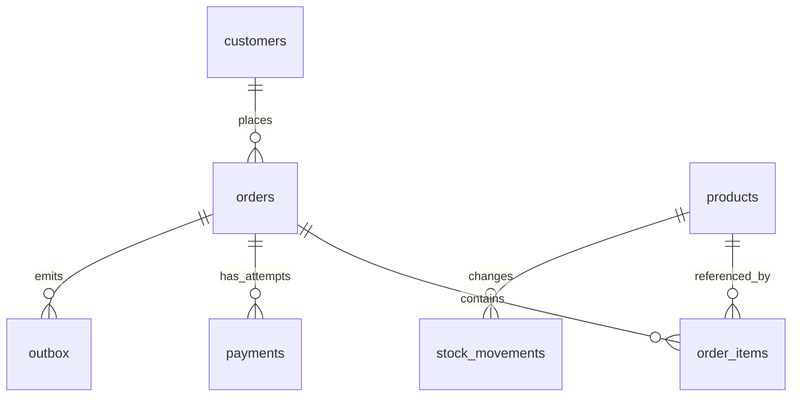

设计表时，我会先写清楚一行代表什么、哪些事实可以改变，再决定字段和约束。商品现在的价格与下单时的价格就是两个事实，混在一起会让历史订单跟着商品改价。

建表细节可以对照[完整脚本](/downloads/database-labs/sql/00-schema.sql)。

## 从事实和关系出发

客户可以拥有多个订单，一个订单可以有多个商品，一个商品可以进入多个订单。因此客户与订单是一对多，订单与商品通过订单明细表达多对多。支付尝试、库存变更和待发送事件也是独立事实，应当有各自的记录。

示例表的关系如下：



订单明细保存购买时的 `unit_price_cents`。商品当前价格可以改变，历史订单金额不应随之改变。订单地址等历史事实同理，应保存履约所需的快照，避免引用可变的当前资料改变历史含义。

## 键和约束各保护什么

主键唯一标识一行，唯一约束保护业务上的不可重复条件，外键保护引用关系，`NOT NULL` 保护必填值，`CHECK` 保护单行可判定规则。

例如 `(customer_id, request_key)` 唯一，表示同一客户的同一请求只能创建一个订单。支付的部分唯一索引表示每个订单最多存在一笔 `succeeded` 支付。它不证明成功金额正确，也不自动把订单改成 `paid`。

`CHECK (stock >= 0)` 能拒绝负库存，但不能单独阻止两个应用请求都根据旧库存判断成功。跨行、跨表、状态转换与并发规则还需要事务和原子写入。PostgreSQL 的 `CHECK` 对结果为 `NULL` 的表达式也视为通过，因此必填列还要声明 `NOT NULL`。

```sql
CREATE TABLE practice.contacts (
    id bigint GENERATED ALWAYS AS IDENTITY PRIMARY KEY,
    customer_id bigint NOT NULL REFERENCES shop.customers(id),
    phone text NOT NULL UNIQUE,
    is_primary boolean NOT NULL DEFAULT false
);
```

如果要求一个客户最多一个主要联系人，可再建立 `ON practice.contacts(customer_id) WHERE is_primary` 的唯一索引。不要用“先查有没有，再插入”替代唯一约束。

## 数据类型就是业务边界

| 事实 | 建议类型与理由 |
|---|---|
| 金额 | 整数最小币种单位，或有明确精度的 `numeric(p,s)`；避免浮点相等与累计误差 |
| 电话、邮编、业务编码 | 文本，保留前导零，不做算术 |
| 事件发生时刻 | `timestamptz`；保存时刻，显示时按会话时区转换 |
| 生日、结算日期 | `date`；不虚构时分秒 |
| 数量 | 有上下限的整数；需要负数的退货事实单独建模 |
| 可扩展元信息 | `jsonb`，核心关联键和金额仍使用明确列与约束 |

`timestamptz` 不保存原始时区名称。如果未来日程依赖“每月上海时间 9 点”，还要保存业务时区与排期规则。示例金额假定单币种；多币种系统必须保存币种、汇率来源、精度和舍入规则，不能直接相加。

## 规范化与冗余

把同一客户的名字复制到每笔订单，会增加更新不一致的机会。把订单商品写成逗号分隔字符串，会让关联、约束和统计困难。通常先让一个事实有一个明确来源，再根据查询成本做受控冗余。

第一范式要求按所选关系模型把属性组织为可操作的单值；第二范式去除非键属性对复合候选键一部分的依赖；第三范式进一步处理非键属性对键的传递依赖。例如明细键是 `(order_id,product_id)`，当前商品名称只依赖商品，不应作为明细中的另一份当前事实；购买时商品名称快照则是不同的历史事实。

默认唯一约束通常允许多个 NULL。如果业务要求缺失值也视为相同，PostgreSQL 可使用 `UNIQUE NULLS NOT DISTINCT`；如果字段根本不能缺失，直接声明 `NOT NULL`。先确定业务语义，不用特殊字符串代替缺失值。

订单头 `total_cents` 是明细合计的冗余快照。示例在同一事务中写入，并提供对账检查。它使高频列表避免反复聚合，但增加了写入和核对责任。冗余必须说明唯一写入入口和修复依据。

自增编号允许空洞，回滚和冲突都可能消耗序列。它不保证业务连续编号，也不能直接证明提交顺序。法定发票号等要求另行设计。

## 动手验证

设计联系人表，保护“客户存在、号码必填、每人最多一个主要号码”。再为多仓库库存设计主键，解释为什么库存应按 `(warehouse_id, product_id)` 区分。写出订单头金额与明细合计的核对查询。

参考：[约束](https://www.postgresql.org/docs/16/ddl-constraints.html)、[数据类型](https://www.postgresql.org/docs/16/datatype.html)。

---

[上一篇：一条 SQL 从执行到落盘经历了什么](/notes/database-02-storage-execution) · [数据库目录](/notes/database-00-learning-guide) · [下一篇：把筛选、NULL 和修改范围写准确](/notes/database-04-sql-basics)
